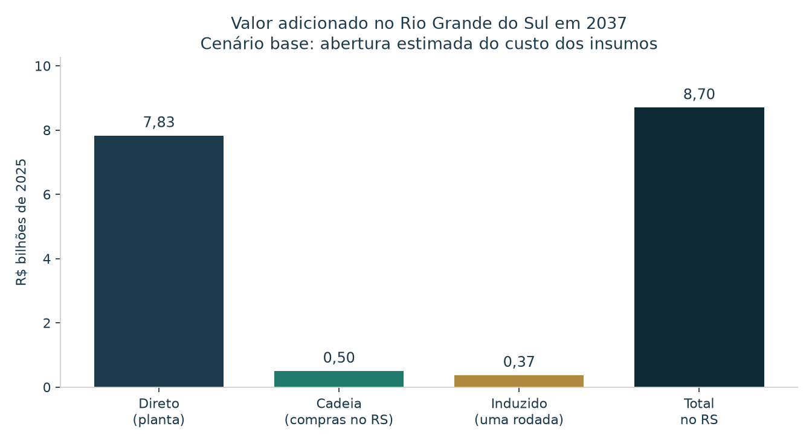
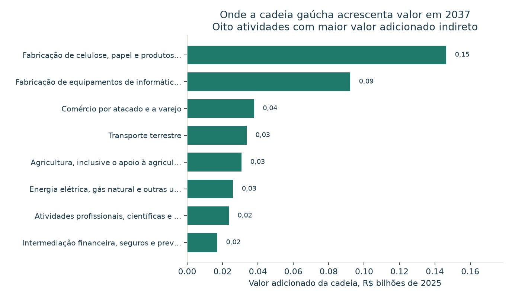
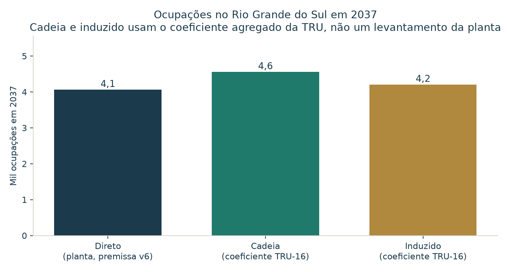
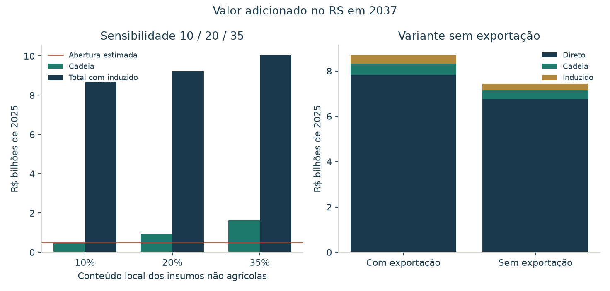
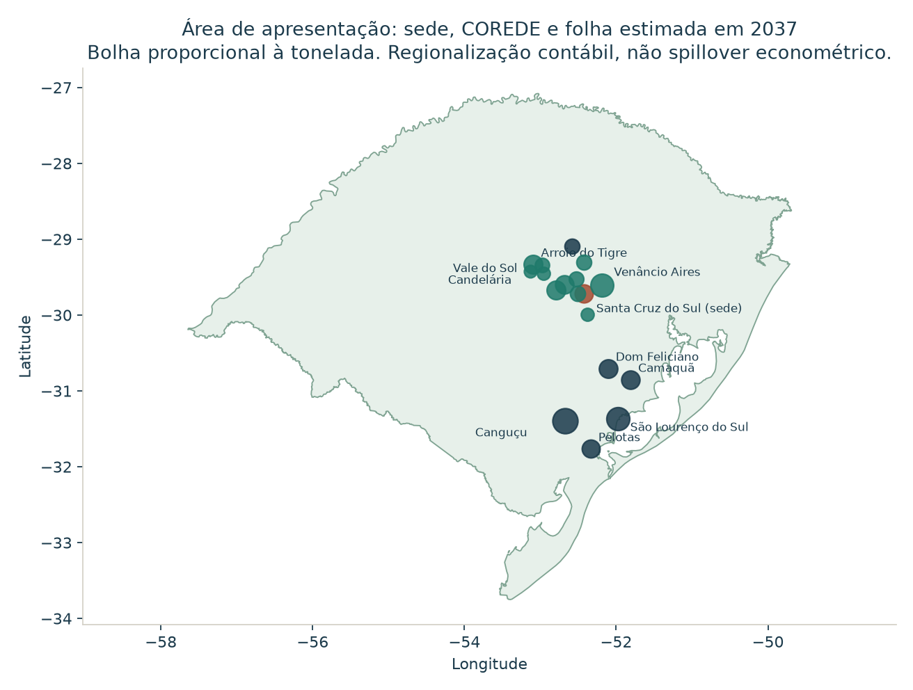
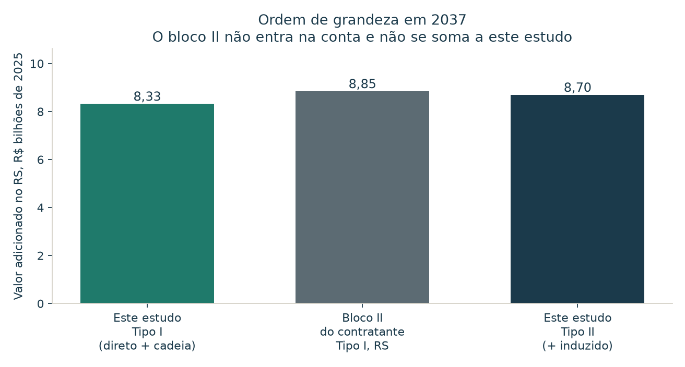

# Impacto econômico da operação de nicotina sem fumaça em Santa Cruz do Sul

Relatório executivo técnico para o Governo do Rio Grande do Sul, o Governo Federal e as prefeituras do COREDE Vale do Rio Pardo.

Outubro de 2026. Operação em ano cheio: **2037**. Preços em **R$ constantes de 2025**. Matriz: **MIP-RS 2019**, DEE/SPGG e UFRJ, **117 produtos × 52 atividades**.

O fluxo da planta segue as premissas de 18/10/2026 (revisão 4). Receita, valor adicionado e ocupação direta são a âncora aceita. O que esta rodada estima é o que estava em branco ao redor deles: a abertura do custo dos insumos, o CAPEX de conversão, uma hipótese de incentivo, a geografia que o dado público fecha e a leitura salarial. Cada estimativa leva a fonte ao lado.

---

## 1. Para o leitor

O objeto medido é a operação, em 2037, de uma planta de produtos de nicotina sem fumaça na fábrica já existente da Philip Morris Brasil em **Santa Cruz do Sul**. Os produtos são sticks de tabaco aquecido, e-líquido com nicotina de folha brasileira e sachês só de exportação. O total calculado é **estadual**. O recorte de apresentação é o **COREDE Vale do Rio Pardo**.

| Manchete | 2037, R$ de 2025 |
|---|---:|
| Emprego direto na planta | **4,06 mil ocupações** |
| Valor adicionado direto da planta | **R$ 7,83 bilhões** |
| Valor adicionado da cadeia no RS | **R$ 499 milhões** |
| Valor adicionado total no RS, com uma rodada de consumo | **R$ 8,70 bilhões** |

O cenário base é a **abertura estimada** do custo dos insumos. Dela sai um conteúdo local de **9,9%** sobre os R$ 7,89 bilhões que não são folha. A compra no Rio Grande do Sul, folha incluída, é de **R$ 830 milhões**. A faixa uniforme de 10/20/35 permanece ao lado, como sensibilidade: a cadeia vai de R$ 474 milhões a R$ 1,64 bilhão. A abertura estimada fica junto do piso de 10%.

A **adicionalidade de 100%** é premissa de capa. Sob ela, o efeito bruto e o efeito líquido da operação coincidem. A linha de cigarros que já existe na fábrica permanece fora do choque.

A obra não entra nessa manchete. O investimento de conversão, estimado em **R$ 1,63 bilhão**, gera um bloco separado de 2026–2027, só sobre a parcela gaúcha de **R$ 484 milhões**.

## 2. O projeto em uma página

A planta fica em Santa Cruz do Sul, na unidade já existente, CNAE 12.20-4. O cenário é de mercado nacional regulado, com 9,9 milhões de usuários no canal legal em 2037, mais exportação para onze países da América Latina. A premissa trata o mercado atual desses produtos como abastecido pelo canal ilegal.

| Linha | Destino em 2037 | Volume |
|---|---|---:|
| E-líquido (pod de 11,36 mL; o custo inclui o dispositivo) | Mercado interno e exportação | 3,074 bilhões de mL |
| Sticks de tabaco aquecido | Mercado interno e exportação | 12,338 bilhões de sticks |
| Sachês de nicotina oral | Só exportação | 0,138 bilhão de unidades |

A receita ex-fábrica a preço básico é de **R$ 15,83 bilhões**: R$ 12,56 bilhões no mercado interno e R$ 3,27 bilhões FOB. Essa receita é o teto contábil da planta. Ela não é o vetor que entra na matriz.

A fábrica compra a folha ao produtor, a preço de porteira. Em 2037 a compra no Sul é de **6,51 mil toneladas** (R$ 114 milhões). A parcela gaúcha, 46% pela proporção da PAM, é de **3,007 mil toneladas** e **R$ 52,8 milhões**. Pela regra de 5,5 toneladas por família, essa compra no RS equivale a **547 famílias**. Família-equivalente é escala de compra. Ela fica ao lado das ocupações e não entra na soma de empregos.

A capacidade de cigarros já instalada (cerca de 15 bilhões de cigarros por ano e cerca de 1,6 mil colaboradores) permanece fora do cenário. A depreciação e a despesa financeira também ficam fora do choque de produção.

### Ficha por unidade, herdada do v6

| | E-líquido | Stick | Sachê |
|---|---:|---:|---:|
| Volume em 2037 | 3,074 bi mL | 12,338 bi sticks | 0,138 bi sachês |
| Dos quais exportação | 0,956 bi mL | 0,918 bi sticks | 100% |
| Insumo por unidade | R$ 2,14 / mL | R$ 0,111 / stick | R$ 0,268 / sachê |
| Folha por unidade | 0,90 g / mL | 0,30 g / stick | 0,27 g / sachê |
| Preço da folha | R$ 15 mil / t | R$ 19,5 mil / t | R$ 15 mil / t |
| Ocupações por milhão de unidades | 0,92 | 0,097 | 0,20 |
| Remuneração por mil unidades | R$ 138 | R$ 14,57 | R$ 30 |

O e-líquido concentra o custo de insumos porque o dispositivo entra no custo do pod. A 0,90 g de folha por mL, com nicotina típica de 2% na folha, a formulação implícita é de cerca de 20 mg de nicotina por mL. Essa leitura calibra o custo de extração. Ela não altera a folha de R$ 114 milhões.

### A rampa até 2037, só na planta

O arquivo traz a trajetória direta da fábrica. Esta rodada multiplica o ano cheio de 2037. A rampa abaixo não passa pela matriz.

| Indicador direto | 2028 | 2032 | 2037 |
|---|---:|---:|---:|
| Receita ex-fábrica | R$ 4,70 bi | R$ 10,68 bi | R$ 15,83 bi |
| Valor adicionado da planta | R$ 2,39 bi | R$ 5,07 bi | R$ 7,83 bi |
| Ocupações na planta | 1,19 mil | 2,81 mil | 4,06 mil |
| Remunerações | R$ 178 mi | R$ 421 mi | R$ 609 mi |
| Folha comprada no RS | R$ 16 mi | R$ 35 mi | R$ 53 mi |

A soma de ocupações-ano de 2028 a 2037 no arquivo (28,2 mil) é a soma de dez estoques anuais. A manchete de emprego permanece o estoque de 2037.

## 3. Abertura estimada do custo dos insumos

O arquivo fixa o bolo: insumos de **R$ 8,00 bilhões**, dos quais a folha é **R$ 114 milhões**. O restante, **R$ 7,89 bilhões**, não vinha aberto. Esta seção o abre por engenharia de porte e por preço público, e reparte cada linha entre Rio Grande do Sul, outros estados e importação.

O produto volume × custo unitário da ficha soma R$ 7,995 bilhões. A âncora arredondada do arquivo é R$ 8,00 bilhões. Um fator de 1,0006 leva as linhas que não são folha até a âncora. O fator não é uma casa decimal de preço. É o encaixe do agregado.

### O que a física explica e o que o dispositivo absorve

No pod, a química cabe em pouco. Com densidade de cerca de 1,15 g/mL, nicotina de 20 mg/mL, aroma a 10% da massa e o restante em partes iguais de glicerina e propilenoglicol, os preços industriais de ponto médio (glicerina R$ 12/kg no intervalo R$ 8–16; propilenoglicol R$ 14/kg no intervalo R$ 10–18; aroma R$ 170/kg, equivalente a cerca de US$ 30/kg na PTAX média de 2025) explicam cerca de **R$ 128 milhões** de químicos no e-líquido, incluída a extração de nicotina além da folha (R$ 440/kg de nicotina, margem sobre o custo da folha). São cerca de R$ 0,50 por pod.

O custo de insumos do pod é de cerca de R$ 24. O residual, **R$ 6,29 bilhões** no ano, é o dispositivo e a eletrônica. A R$ 5,59 por dólar (PTAX venda média de 2025), isso é cerca de US$ 4 por pod, no topo da faixa publicada de custo de fabricação de descartável de alta capacidade (US$ 2,50 a US$ 5, Vapor Authority; o exemplo de fornecedor chinês da Keystone põe os materiais, sem mão de obra, em cerca de US$ 2,70). A mão de obra não está neste bolo: ela está nos R$ 609 milhões de remuneração.

No stick, a folha já saiu a R$ 19.500/t. O que sobra por stick é sobretudo papel, filtro e embalagem (**R$ 1,12 bilhão**). Glicerina do bastão (50 mg, ponto médio de 30–70 mg), ligante e aroma somam **R$ 47 milhões**.

### Energia e água

A intensidade de partida é a da manufatura da PMI em 2022: **7,56 GJ por milhão de cigarros-equivalentes** (demonstração assegurada dos indicadores de meio ambiente). A eletricidade era 46% dessa energia de fábrica. Para o stick e o sachê usa-se o ponto médio de 1 a 3 vezes essa intensidade, porque a secagem da folha reconstituída consome mais que o cigarro médio. Para o e-líquido, o ponto médio de 1 a 5 vezes, pela incerteza do análogo. A tarifa industrial é o ponto médio de **R$ 400 a R$ 700 por MWh**, **R$ 550**. O resultado é **72 mil MWh** e **R$ 40 milhões**. Se intensidade e tarifa caminharem juntas para os extremos do intervalo, a conta cabe entre cerca de R$ 15 milhões e R$ 70 milhões. O cenário base usa o meio.

A água usa 3,79 m³ por milhão de cigarros-equivalentes (a mesma fonte PMI, 2022) e os mesmos múltiplos, a **R$ 15/m³** (ponto médio de R$ 10–20, água e esgoto industrial). São cerca de **130 mil m³** e **R$ 2 milhões**. É ordem de grandeza, declarada como tal.

A energia faturada no Rio Grande do Sul entra 100% local. A matriz já vaza, na cadeia da utility, a geração comprada de fora. O coeficiente de 66% de oferta gaúcha do produto eletricidade (PR080) descreve a média do setor. Ele não desconta a fatura da planta.

### A abertura, em R$ de 2025

| Linha | Valor | Parcela RS | Compra no RS | Outros estados | Importado |
|---|---:|---:|---:|---:|---:|
| Dispositivo e eletrônico do pod | R$ 6.295 mi | 5% | R$ 315 mi | R$ 629 mi | R$ 5.351 mi |
| Químicos (glicerina, propilenoglicol, aroma, extração, stick e sachê) | R$ 193 mi | 21% | R$ 40 mi | R$ 94 mi | R$ 59 mi |
| Papel, filtro e embalagem | R$ 1.186 mi | 26% | R$ 305 mi | R$ 533 mi | R$ 348 mi |
| Energia | R$ 40 mi | 100% | R$ 40 mi | — | — |
| Água | R$ 2 mi | 100% | R$ 2 mi | — | — |
| Frete interno até a planta | R$ 52 mi | 100% | R$ 52 mi | — | — |
| Manutenção | R$ 119 mi | 20% | R$ 24 mi | R$ 36 mi | R$ 60 mi |
| **Insumos que não são folha** | **R$ 7.886 mi** | **9,9%** | **R$ 777 mi** | **R$ 1.292 mi** | **R$ 5.817 mi** |
| Folha no RS | R$ 53 mi | dada | R$ 53 mi | — | — |
| Folha em SC e no PR | R$ 61 mi | 0% | — | R$ 61 mi | — |
| **Insumos totais** | **R$ 8.000 mi** | | **R$ 830 mi** | | |

O conteúdo local implícito dos insumos que não são folha é **9,9%**. Com a folha gaúcha, a compra no RS é **R$ 830 milhões**. O vazamento, registrado e não multiplicado, é **R$ 7,17 bilhões**.

A origem usa a MIP-RS 2019 como teto ou piso e aplica um desconto quando o bem é mais específico que a média do produto. No consumo intermediário da matriz, material eletrônico (PR066) é 8,2% gaúcho: o pod fica em 5%, porque o descartável é mais importado que a média da eletrônica. Papel e embalagem (PR036) são 39,7% gaúchos: papel de cigarro e filtro de acetato ficam em 25%. Químicos orgânicos (PR047) são 65% gaúchos, por causa do polo: a glicerina de biodiesel fica em 35%, e o propilenoglicol em 10%, porque a oferta petroquímica está concentrada em outros estados. Químicos diversos (PR051) são 40,3% gaúchos: aroma e sachê ficam abaixo disso. Obra, energia faturada, água e frete interno ficam locais. Manutenção (PR079) é 30,2% gaúcha e 5% importada na média: a peça de máquina da PMI vai a 20% no RS e 50% importada.

Frete interno é a perna doméstica até a planta (contêiner de Rio Grande a Santa Cruz no dispositivo, mais o frete dos insumos a granel). A distribuição ao varejo continua fora do custo dos insumos, na margem do arquivo. Manutenção é 0,6% do custo não agrícola do e-líquido e 6% do stick e do sachê: a linha de stick desgasta máquina própria; o pod chega comprado.

## 4. Premissas contábeis usadas

| Item | Com exportação | Só mercado interno | Papel na conta |
|---|---:|---:|---|
| Receita ex-fábrica, preço básico | R$ 15,83 bi | R$ 12,56 bi | Teto contábil. Fica fora do vetor de choque |
| Insumos | R$ 8,00 bi | R$ 5,81 bi | Base das compras |
| Valor adicionado direto | R$ 7,83 bi | R$ 6,75 bi | Gaveta direta, uma vez |
| Remunerações diretas | R$ 609 mi | R$ 459 mi | R$ 150 mil por ocupação, com encargos. Premissa, não trocada |
| Ocupações diretas | 4,06 mil | 3,06 mil | Estoque de 2037 |
| Folha no RS | 3,007 mil t; R$ 52,8 mi | 2,465 mil t; R$ 44 mi | 46% do Sul |
| Conteúdo local dos insumos que não são folha | **9,9% estimado** | 10,8% na variante interna | Resultado da abertura, não percentual único |
| Faixa de sensibilidade | 10 / 20 / 35% | | Uniforme, ao lado da abertura |
| Adicionalidade | 100% | 100% | Premissa de capa |

O valor adicionado interno é R$ 12,56 bi − R$ 5,81 bi = **R$ 6,75 bi**. A remuneração interna é 3,06 mil × R$ 150 mil = **R$ 459 milhões**.

Cargas de memória do cenário: **39%** do preço de varejo no vape e no sachê e **51%** no tabaco aquecido. A meta de tributos sobre o consumo no Brasil em 2037 é **R$ 13,7 bilhões**. A parcela do consumo no RS é cerca de **6,8%**, **R$ 0,93 bilhão**, dos quais **R$ 0,48 bilhão** estaduais e municipais. O IRPJ/CSLL da planta, pela regra do arquivo (34% sobre 50% do excedente), é **R$ 1,23 bilhão**, federal.

## 5. Como a conta foi feita

Três gavetas na operação de 2037, e um bloco de obra que não se soma a elas.

**Gaveta 1, efeito direto.** Valor adicionado, ocupações e remunerações da planta, uma vez, com os números do arquivo.

**Gaveta 2, cadeia.** Só a compra feita no Rio Grande do Sul, a preço básico, entra na inversa de Leontief. No cenário base essa compra é a da abertura estimada.

**Gaveta 3, vazamento.** Compra fora do RS, registrada e não multiplicada.

**Bloco de obra, 2026–2027.** Choque só da parcela gaúcha do CAPEX estimado. Não entra no fluxo anual de 2037. Depreciação não é consumo intermediário. Capital de giro fica fora do choque e é mostrado à parte.

A matriz é a MIP-RS 2019, DEE/SPGG e UFRJ, 117 produtos × 52 atividades. A inversa foi recalculada da tabela 13 e conferida com a tabela 14: o maior desvio é da ordem de 10⁻¹⁵. O fator de preço é o IPCA (SIDRA 1737): **5.320,25** em dezembro de 2019 e **7.403,29** em dezembro de 2025. φ = 0,7186. Ocupação não se deflaciona.

Remuneração e ocupação da cadeia usam a TRU de 16 atividades do mesmo projeto. Papel, químico e eletrônico herdam a intensidade de toda a indústria de transformação gaúcha de 2019.

A camada induzida converte **60%** da massa salarial gerada no RS em consumo das famílias, no perfil da tabela 3, **uma rodada**. O Tipo I é direto mais cadeia. O Tipo II soma essa rodada. Os dois não se somam ao bloco II do contratante.

## 6. Resultados do ano cheio de 2037

Cenário base: abertura estimada, exportação incluída, uma rodada de consumo. R$ de 2025.

| Gaveta | Valor adicionado | Remunerações | Ocupações | Produção |
|---|---:|---:|---:|---:|
| Direto, planta | R$ 7.830 mi | R$ 609 mi | 4.060 | R$ 15.830 mi (receita) |
| Cadeia, compras no RS | R$ 499 mi | R$ 187 mi | 4.555 | R$ 1.297 mi |
| Induzido, uma rodada | R$ 371 mi | R$ 144 mi | 4.202 | R$ 714 mi |
| **Total no RS (Tipo II)** | **R$ 8.700 mi** | **R$ 941 mi** | **12.817** | |
| Total sem induzido (Tipo I) | R$ 8.329 mi | R$ 796 mi | 8.615 | |

A leitura de decisão é: cadeia de **R$ 499 milhões**, induzido de **R$ 371 milhões**, total de **R$ 8,70 bilhões**, cerca de **12,8 mil ocupações**. A compra multiplicada é de R$ 830 milhões. Cada real comprado no RS gera R$ 1,56 de produção gaúcha e R$ 0,60 de valor adicionado.

A rodada de consumo devolve R$ 0,18 de salário novo por real consumido. A série fechada multiplicaria o valor adicionado induzido por 1,22, cerca de **R$ 80 milhões** a mais. A manchete permanece a da rodada única.

### Onde a cadeia acrescenta valor

| Atividade | Valor adicionado da cadeia | Produção da cadeia |
|---|---:|---:|
| Celulose, papel e embalagens | R$ 146 mi | R$ 331 mi |
| Equipamentos de informática e eletrônicos | R$ 92 mi | R$ 361 mi |
| Comércio | R$ 38 mi | R$ 64 mi |
| Transporte terrestre | R$ 34 mi | R$ 94 mi |
| Agricultura | R$ 31 mi | R$ 52 mi |
| Energia elétrica e gás | R$ 26 mi | R$ 66 mi |
| Serviços profissionais | R$ 24 mi | R$ 37 mi |
| Intermediação financeira | R$ 17 mi | R$ 26 mi |

Papel e eletrônico lideram porque são os dois maiores endereços da compra gaúcha (embalagem do stick e a fração local do dispositivo). Energia, transporte e manutenção aparecem com linha própria, o que a rodada do percentual único não separava. A agricultura entra pela folha de R$ 52,8 milhões.

| Origem | Ocupações em 2037 | Como ler |
|---|---:|---|
| Planta | 4.060 | Premissa v6. Estoque do ano cheio |
| Cadeia | 4.555 | Coeficiente da TRU-16 sobre a produção gerada |
| Consumo das famílias | 4.202 | O mesmo coeficiente, sobre a rodada de consumo |
| Famílias-equivalentes da folha no RS | 547 | 3.007 t ÷ 5,5 t. Fora da soma |

## 7. Faixa de 10/20/35, ao lado da abertura

A faixa é uma sensibilidade uniforme: 10%, 20% ou 35% dos insumos que não são folha são tratados como compra gaúcha, com a composição da rodada anterior (dispositivo, químicos e papel). Ela não substitui a abertura. Serve para o leitor medir a distância.

| Cenário | Compra no RS | VAB da cadeia | VAB total com induzido | Ocupações totais |
|---|---:|---:|---:|---:|
| **Abertura estimada (base, 9,9%)** | **R$ 0,83 bi** | **R$ 499 mi** | **R$ 8,70 bi** | **12,8 mil** |
| Conteúdo local uniforme de 10% | R$ 0,84 bi | R$ 474 mi | R$ 8,67 bi | 12,8 mil |
| Conteúdo local uniforme de 20% | R$ 1,63 bi | R$ 938 mi | R$ 9,22 bi | 17,5 mil |
| Conteúdo local uniforme de 35% | R$ 2,81 bi | R$ 1,64 bi | R$ 10,05 bi | 24,6 mil |

A abertura fica ao lado dos 10%. O dispositivo importado é o que impede o 20% de ser o caso central. O valor adicionado direto não se move com a faixa.

### Sem exportação

A variante retira a receita FOB de R$ 3,27 bilhões, os insumos de exportação de R$ 2,19 bilhões e as 1,00 mil ocupações da exportação. A mesma abertura é aplicada aos volumes internos e reancorada em R$ 5,81 bilhões de insumos.

| | Com exportação | Sem exportação |
|---|---:|---:|
| Valor adicionado direto | R$ 7,83 bi | R$ 6,75 bi |
| Valor adicionado da cadeia | R$ 499 mi | R$ 403 mi |
| Valor adicionado induzido | R$ 371 mi | R$ 283 mi |
| **Total no RS** | **R$ 8,70 bi** | **R$ 7,44 bi** |
| Ocupações diretas | 4,06 mil | 3,06 mil |
| Ocupações totais | 12,8 mil | 9,9 mil |
| Compra no RS | R$ 830 mi | R$ 659 mi |

O Tipo I com exportação é **R$ 8,33 bilhões** e **8,6 mil ocupações**. É a linha que se compara ao bloco II.

## 8. CAPEX da conversão e a obra de 2026–2027

O terreno vale zero: a unidade já existe. O galpão também. O projeto é linha nova de sem fumaça dentro da planta, com operação a partir de 2028 e obra hipotética em 2026–2027.

O anúncio argentino de até US$ 500 milhões não é o número desta planta. Ele entra, com os outros, só como calibração.

| Referência | O que foi anunciado | Uso nesta conta |
|---|---|---|
| Papastratos, Grécia, 2017 (PMI) | €300 milhões para converter fábrica de cigarro e chegar a cerca de 20 bilhões de sticks | Régua de conversão: €15 por milhão de sticks ao ano. Escala para 12,3 bilhões e desconto de 15% porque o galpão já existe |
| Crespellano, Itália (PMI) | €500 milhões para cerca de 30 bilhões de sticks na primeira fase; €1,2 bilhão entre 2013 e 2020 num greenfield que chegou a dezenas de bilhões | Confere a ordem de grandeza do greenfield, que custa pelo menos tanto quanto a conversão |
| Dresden, Alemanha, 2017 (PMI) | US$ 320 milhões, fábrica nova, capacidade não publicada | Ordem de grandeza, sem virar régua por unidade |
| Merlo, Argentina | US$ 300 milhões suspensos em 2023 (US$ 180 milhões de ampliação e US$ 120 milhões de máquinas, La Nación); fala posterior de até US$ 500 milhões, sem capacidade publicada | Não é o CAPEX desta planta. Mostra que conversão reparte obra e máquina |

A conta, em R$ de 2025, usa a PTAX venda média de 2025: **US$ 1 = R$ 5,59** e **€ 1 = R$ 6,31** (BCB, 1.254 cotações).

| Pedaço | Valor | Origem |
|---|---:|---|
| Linha de sticks | R$ 992 mi | €157 milhões: 12,3/20 × €300 mi × 0,85 |
| Linha de e-líquido | R$ 559 mi | Ponto médio de US$ 50–150 milhões para envase e montagem de 271 milhões de pods |
| Linha de sachê | R$ 84 mi | Ponto médio de US$ 8–25 milhões |
| **CAPEX da conversão** | **R$ 1,63 bi** | Estimativa |
| Dos quais máquinas importadas | R$ 1,01 bi | 62%. Hipótese: máquina proprietária da PMI |
| Obras civis e utilidades no RS | R$ 294 mi | 18%. Menos que um greenfield |
| Montagem no RS | R$ 137 mi | 8,4% |
| Engenharia no RS | R$ 52 mi | 3,2% |
| Montagem e engenharia importadas | R$ 137 mi | O complemento |
| **Parcela gaúcha, que entra na matriz** | **R$ 484 mi** | 30% do CAPEX |
| Terreno | R$ 0 | Planta existente |
| Capital de giro, 45 dias do custo de insumos | R$ 986 mi | Fora do choque |
| Piso observado na fábrica | R$ 100 mi ou mais | Deck citado nas premissas. Não é o CAPEX do projeto |

O piso de R$ 100 milhões é o que as premissas registram como investimento em curso, sem anúncio público localizado. Ele fica abaixo do CAPEX estimado e não o substitui.

### Efeito da obra, separado de 2037

O choque usa só os R$ 484 milhões gaúchos: edificações (PR082), montagem (PR079) e engenharia (PR102). Tipo I, sem a rodada de consumo, para não misturar com o induzido da operação.

| Efeito da obra no RS | Valor |
|---|---:|
| Produção gerada | R$ 740 mi |
| Valor adicionado | R$ 342 mi |
| Remunerações | R$ 125 mi |
| Ocupações do Leontief da obra | 4,4 mil |
| Das quais postos temporários na construção | 2,6 mil |

Os 2,6 mil postos são o coeficiente de ocupação da Construção na TRU (11,1 ocupações por R$ milhão de produção de 2019) aplicado à produção de construção que o pedaço local de obra gera. São postos do biênio, temporários. Não entram nas 4,06 mil da planta nem nas 12,8 mil de 2037.

O ISS de Santa Cruz do Sul sobre a obra está na seção fiscal.

## 9. Retorno fiscal da hipótese de referência

O incentivo não foi concedido à Philip Morris Brasil. O que segue é uma política hipotética de referência, para o retorno deixar de ficar em branco.

O programa vigente (Lei 15.642/2021 e Resolução Normativa do FUNDOPEM/INTEGRAR consolidada até a RN 11/2025, Secretaria de Desenvolvimento Econômico) financia parte do ICMS incremental. O teto mensal prático do incentivo básico, fora cooperativa, é **75%** do ICMS incremental, com fruição de até **96 meses**, atualização pelo IPCA e juros de até 2% ao ano para empresa grande. O teto legal citado pela secretaria chega a 90% do ICMS incremental, limitado também a 9% do faturamento bruto incremental. O INTEGRAR abate de 10% a 90% de cada parcela a amortizar, conforme o IDESE do município ou do COREDE, emprego e meio ambiente.

O Regime de Recuperação Fiscal (LC 159/2017, art. 8º, e o Propag) restringe benefício novo que reduza receita. O instrumento que o Estado tem concedido nesse ambiente, o FUNDOPEM Recupera Avança, fica em **30%** do ICMS com financiamento, ou 27% sem financiamento (Plano Rio Grande). Por isso a hipótese usa 30%, não o teto de 75%.

**Hipótese de referência.** Financiamento de **30%** do ICMS incremental atribuível ao consumo no Rio Grande do Sul, por **96 meses**, custo IPCA mais até 2% ao ano, **sem abatimento do INTEGRAR**. Não é benefício protocolado nem aprovado.

O ICMS incentivável é o da operação atribuível ao RS, **R$ 0,48 bilhão**, não os R$ 13,7 bilhões nacionais. Desses R$ 0,48 bilhão, a cota-parte municipal constitucional de 25% é **R$ 120 milhões**, distribuída pela regra de partilha do Estado, e o Tesouro estadual fica com **R$ 360 milhões**. A cota-parte não é receita de Santa Cruz do Sul: o Valor Adicionado Fiscal do município-sede não está calculado.

| Canal em 2037 | Valor | Esfera |
|---|---:|---|
| Tributos sobre o consumo no Brasil | R$ 13,7 bi | Federal R$ 6,58 bi; estados e municípios do Brasil R$ 7,12 bi |
| Tributos sobre o consumo no RS | R$ 0,93 bi | Dos quais R$ 0,45 bi federais e R$ 0,48 bi de ICMS |
| ICMS estadual, líquido da cota | R$ 360 mi | Estado |
| Cota-parte municipal do ICMS do consumo no RS | R$ 120 mi | Municípios gaúchos, pela regra de partilha |
| **Bruto estadual e municipal no RS** | **R$ 480 mi** | Retorno do RS, antes da hipótese |
| IRPJ/CSLL da planta | R$ 1,23 bi | Federal. Fora do retorno do RS |
| Diferimento da hipótese (30% de R$ 480 mi) | R$ 144 mi | Caixa adiado, não renúncia permanente |
| **Líquido de caixa no ano em que a fruição vigora** | **R$ 336 mi** | R$ 480 mi menos R$ 144 mi |
| Renúncia permanente desta hipótese | R$ 0 | Sem INTEGRAR, o financiado é pago depois |
| ISS da obra em Santa Cruz do Sul | R$ 4,8 mi | Uma vez, em 2026–2027. Fora do ano de 2037 |

O ISS usa a alíquota de **2%** do item 7.02 da lista de serviços de Santa Cruz do Sul (execução de obra por empreitada) sobre metade da parcela local do CAPEX. A metade é o ponto médio de uma obra em que materiais seguem no ICMS e serviços no ISS. Base de R$ 242 milhões × 2% = **R$ 4,8 milhões**, estimativa, município-sede, biênio da obra.

Se a fruição de 96 meses começa com a operação, em 2028, ela se encerra em 2035. Em 2037, nesse calendário, o diferimento já teria acabado e o líquido do ano cheio volta a ser o bruto de R$ 480 milhões. O R$ 336 milhões é o caixa do ano de porte cheio **enquanto a hipótese estiver vigente**.

Com o IBS no destino, a sede da fábrica não traz para o Rio Grande do Sul o tributo sobre o consumo dos outros estados. A base incentivável continua sendo o consumo gaúcho. A hipótese já está desenhada nessa base estreita. Um ICMS de origem, cobrado em Santa Cruz sobre a venda nacional, seria outra base, maior, e não é a desta conta.

## 10. Onde isso aparece no território

O modelo é estadual. O que segue é regionalização contábil: folha pela PAM, salário pela pendularidade publicada, resto da cadeia no estado. Não é modelo econométrico de spillover. Um spillover de verdade exigiria a matriz de origem e destino do emprego, o endereço do fornecedor e uma estimativa de vizinhança. Esta entrega não faz isso, e o mapa abaixo se chama área de apresentação.

### Os 23 municípios do COREDE Vale do Rio Pardo

Fonte: estatuto do COREDE Vale do Rio Pardo e Plano Estratégico de Desenvolvimento 2022–2030. São 23:

Arroio do Tigre, Boqueirão do Leão, Candelária, Encruzilhada do Sul, Estrela Velha, General Câmara, Herveiras, Ibarama, Lagoa Bonita do Sul, Mato Leitão, Pantano Grande, Passa Sete, Passo do Sobrado, Rio Pardo, Santa Cruz do Sul, Segredo, Sinimbu, Sobradinho, Tunas, Vale do Sol, Vale Verde, Venâncio Aires e Vera Cruz.

### Folha pela PAM 2025

Fonte: IBGE, SIDRA, tabela 1612, produto 2703 (fumo em folha), variável quantidade produzida, ano 2025, consulta em outubro de 2026. A regra do arquivo é produção municipal × 0,86%.

| | PAM 2025 | 0,86% |
|---|---:|---:|
| Rio Grande do Sul | 349.928 t | 3.009 t |
| Santa Catarina | 220.728 t | 1.898 t |
| Paraná | 186.505 t | 1.604 t |
| Sul | 757.161 t | 6.512 t |

A parcela aceita no RS é **3.007 mil toneladas**. A regra aplicada ao SIDRA soma **3.009 t**. O resíduo é de **2 t**, o arredondamento entre 0,86% da PAM e os 46% de 6,51 mil toneladas escritos no arquivo (a PAM dá 46,2%). As toneladas municipais do RS foram reescaladas por 3.007/3.009 para a soma fechar na âncora. O valor municipal usa R$ 17.561/t, a média do arquivo, e por isso soma os R$ 52,8 milhões.

Os exemplos de imprensa citados nas premissas não batem com o SIDRA 2025, exceto Santa Cruz do Sul. Canguçu está em 26.156 t, não em 21.064. Venâncio Aires em 21.242 t, não em 17.779. São Lourenço do Sul em 21.600 t, não em 16.374. Candelária em 13.500 t, não em 11.462. Santa Cruz do Sul permanece em 12.610 t. A conta usa o SIDRA.

| Município | PAM 2025 | Folha nova em 2037 |
|---|---:|---:|
| Canguçu | 26.156 t | 225 t |
| São Lourenço do Sul | 21.600 t | 186 t |
| Venâncio Aires | 21.242 t | 183 t |
| Candelária | 13.500 t | 116 t |
| Arroio do Tigre | 13.464 t | 116 t |
| Vale do Sol | 12.974 t | 111 t |
| Santa Cruz do Sul | 12.610 t | 108 t |
| Vera Cruz | 8.126 t | 70 t |

No COREDE, as 23 cidades somam **1.243 t** de folha nova, **R$ 22 milhões** e **226 famílias-equivalentes**. É 41% da folha gaúcha. O restante da folha do RS está fora do COREDE, com peso em Canguçu, São Lourenço do Sul e na Metade Sul. A lista completa está em `resultados/folha_municipios.csv`.

### Salário direto por município de residência

O microdado de origem e destino do Censo 2022 não está na divulgação de deslocamento (tabelas 10329 a 10338 trazem tempo e meio de transporte, não o município de trabalho). A tabela publicada usada é a do Censo 2010, reproduzida na Revista Jovens Pesquisadores (UNISC, 2015, tabela 4): pessoas ocupadas cujo trabalho principal ficava em outro município, e as 62.396 ocupadas de Santa Cruz do Sul que trabalhavam no próprio município.

O destino desse fluxo de saída não está na tabela. O fator de destino 0,5 é o ponto médio entre zero (ninguém desse fluxo trabalha em Santa Cruz) e um (todo esse fluxo do entorno trabalha em Santa Cruz). O entorno é o eixo citado nas premissas mais os municípios contíguos com fluxo material no Censo 2010: Vera Cruz, Venâncio Aires, Rio Pardo, Candelária, Mato Leitão, Sinimbu, Vale do Sol, Passo do Sobrado, Herveiras, Boqueirão do Leão e General Câmara. Municípios distantes do COREDE não recebem salário da planta por essa regra: o emprego “em outro município” deles não tem destino publicado.

No ponto médio, **92%** das 4,06 mil ocupações e dos R$ 609 milhões ficam com residentes de Santa Cruz do Sul. Os outros **8%** são pendulares. No extremo do intervalo, a parcela pendular vai de 0% a 15%.

| Município de residência | Ocupações | Remuneração |
|---|---:|---:|
| Santa Cruz do Sul | 3.728 | R$ 559 mi |
| Vera Cruz | 89 | R$ 13 mi |
| Rio Pardo | 85 | R$ 13 mi |
| Venâncio Aires | 65 | R$ 10 mi |
| Candelária | 35 | R$ 5 mi |
| Demais do entorno | 58 | R$ 9 mi |
| **Planta** | **4.060** | **R$ 609 mi** |

Isso distribui o salário direto. Não distribui a cadeia de papel, químico e eletrônico, que permanece estadual.

## 11. Leitura salarial, sem trocar o direto

As 4,06 mil ocupações e os R$ 609 milhões permanecem. R$ 150 mil por ocupação, com encargos, é a premissa v6.

O confronto usa duas fontes de folha de pagamento da indústria do fumo, trazidas a R$ de 2025 pelo IPCA.

| Fonte | O que mede | Em R$ do ano | Em R$ de 2025 | Com encargos patronais de 36,8% |
|---|---|---:|---:|---:|
| CEMPRE, IBGE, tabela 6450, 2021, Santa Cruz do Sul, divisão 12 | R$ 338 milhões de salários para 3.136 assalariados | R$ 108 mil / pessoa | R$ 130 mil | R$ 178 mil |
| PIA-Empresa, IBGE, tabela 1849, 2023, Rio Grande do Sul, divisão 12 | R$ 733 milhões para 6.165 pessoas ocupadas em 31/12 | R$ 119 mil / pessoa | R$ 130 mil | R$ 178 mil |
| Premissa v6 | Ocupação com encargos | | | **R$ 150 mil** |

Os 36,8% são a soma das alíquotas legais que não estão dentro de “salários e outras remunerações”: INSS patronal 20%, RAT 3%, Sistema S e salário-educação cerca de 5,8%, FGTS 8%. É alíquota de referência, não a folha auditada da planta. O 13º já está na rubrica anual do CEMPRE e da PIA.

R$ 150 mil fica cerca de **16% abaixo** dos R$ 178 mil. O sentido do viés é para baixo: a premissa aceita é baixa frente ao custo carregado da indústria do fumo gaúcha em 2021–2023, não alta. Uma planta formal da Philip Morris está mais perto dessa folha do que de uma média que misture informalidade.

Um quadro plausível, calibrado para reproduzir cerca de R$ 10 mil mensais (os R$ 130 mil anuais divididos por 13), em R$ de 2025:

| Função | Parcela das 4,06 mil | Salário mensal de referência |
|---|---:|---:|
| Produção e operação | 55% (2,2 mil) | R$ 8,0 mil |
| Manutenção | 15% (0,6 mil) | R$ 11,5 mil |
| Administração e suporte | 15% (0,6 mil) | R$ 13,0 mil |
| Técnicos de processo e qualidade | 8% (0,3 mil) | R$ 15,0 mil |
| Técnico de campo | 7% (0,3 mil) | R$ 9,5 mil |

A média desse quadro é R$ 9,9 mil por mês, R$ 129 mil no ano com o 13º. É ilustração em volta do CEMPRE. Não é a RAIS por ocupação, que não está publicada nesse corte, e não substitui os R$ 609 milhões.

## 12. Comparação com o bloco II do contratante

O bloco II é o Tipo I do modelo inter-regional do contratante, em 2037, no RS: valor adicionado de **R$ 8,85 bilhões**, **12,76 mil ocupações** e tributos sobre o consumo de **R$ 0,928 bilhão**. Ele não entra como choque.

| | Este estudo, Tipo I, abertura estimada | Bloco II | Este estudo, sensibilidade de 20% | Este estudo, Tipo II |
|---|---:|---:|---:|---:|
| Valor adicionado no RS | R$ 8,33 bi | R$ 8,85 bi | R$ 8,77 bi | R$ 8,70 bi |
| Ocupações no RS | 8,6 mil | 12,76 mil | 12,4 mil | 12,8 mil |

Na abertura estimada, o Tipo I fica cerca de 6% abaixo do bloco II em valor adicionado e bem abaixo em ocupações, porque a compra gaúcha encolheu com o dispositivo importado. A sensibilidade uniforme de 20% continua ao lado do bloco II, como na rodada anterior. As premissas já avisam que diferenças de 10% a 20% entre matrizes são o esperado. O encaixe apertado da rodada de 20% dependia daquela hipótese. Ele não sobrevive à abertura.

O Tipo II da abertura (R$ 8,70 bilhões e 12,8 mil ocupações) não se soma ao bloco II.

## 13. O que ainda ficou sem estimativa

A conta agora cobre o que era estimável com fonte pública ou com engenharia de porte. Ficou de fora o que depende de documento da empresa ou de dado que não foi publicado:

O contrato de incentivo não existe nesta conta. A hipótese de 30% por 96 meses não é protocolo, parecer do GATE nem termo de ajuste.

A nota fiscal de insumo e a lista de fornecedores por município não estão no arquivo. A abertura substitui o branco. Ela não substitui o compras da empresa.

O projeto de investimento da PMB não foi entregue. O CAPEX de R$ 1,63 bilhão é calibração por anúncio e por porte, com desconto de galpão existente. O piso de R$ 100 milhões em curso é outra informação, do deck, e continua sem objeto e prazo confirmados.

O município de moradia de cada empregado e o contracheque por função não foram abertos pelo RH. A pendularidade é proxy de 2010 com fator de destino explícito. O quadro salarial é a média do CEMPRE e da PIA, não a ocupação CBO.

O Valor Adicionado Fiscal de Santa Cruz do Sul, e portanto a cota-parte que ficaria na sede, depende dos pesos da partilha. A cota de R$ 120 milhões é a do conjunto dos municípios gaúchos.

A matriz origem-destino do Censo 2022 não foi publicada no recorte casa-trabalho por município. Sem ela não há spillover espacial estimado.

Depreciação, despesa financeira e o capital de giro de R$ 986 milhões estão quantificados ou reconhecidos e ficam fora do choque de produção, porque não são consumo intermediário do ano de operação.

## 14. Anexo: fórmula, setores e fontes

### Setores do choque de operação, cenário base, R$ de 2025

| Código | Produto | Compra no RS |
|---|---|---:|
| PR066 | Material eletrônico e equipamentos de comunicações | R$ 315 mi |
| PR036 | Papel, papelão, embalagens e artefatos | R$ 305 mi |
| PR086 | Transporte de carga | R$ 52 mi |
| PR004 | Outros produtos da lavoura temporária (folha) | R$ 53 mi |
| PR080 | Eletricidade, gás e outras utilidades | R$ 40 mi |
| PR051 | Produtos químicos diversos | R$ 32 mi |
| PR079 | Manutenção e instalação de máquinas | R$ 24 mi |
| PR047 | Produtos químicos orgânicos | R$ 9 mi |
| PR081 | Água, esgoto e resíduos | R$ 2 mi |

O choque direto sobre a fabricação de produtos do fumo é zero. A atividade recebe só o encadeamento residual.

O choque de obra, separado, é PR082 edificações R$ 294 milhões, PR079 montagem R$ 137 milhões e PR102 engenharia R$ 52 milhões.

### Fórmula

g é o vetor de compras no RS, em R$ milhões de 2019, a preço básico. D é a participação das atividades na produção de cada produto. A é a matriz de coeficientes técnicos locais. v é o valor adicionado por real de produção.

f = D g. x = (I − A)⁻¹ f. VAB da cadeia = v · x.

g de 2019 = g de 2025 × (5.320,25 / 7.403,29).

O consumo induzido, numa rodada, é 60% do salário direto mais o salário da cadeia, no perfil de consumo das famílias. O vazamento é o custo dos insumos menos a compra no RS: R$ 8,00 bi − R$ 0,83 bi = R$ 7,17 bi.

### Fontes

1. DEE/SPGG e UFRJ. MIP-RS 2019, 117 × 52, e TRU 2019. https://dee.rs.gov.br/matriz-insumo-produto . Origem da oferta: participação do consumo intermediário local nas tabelas 3, 4 e 5.
2. IBGE. IPCA, SIDRA 1737. Dezembro de 2019: 5.320,25. Dezembro de 2021: 6.120,04. Dezembro de 2023: 6.773,27. Dezembro de 2025: 7.403,29.
3. IBGE. PAM, SIDRA 1612, produto 2703, variável 214, 2025.
4. IBGE. CEMPRE, SIDRA 6450, 2021, Santa Cruz do Sul, CNAE divisão 12. PIA-Empresa, SIDRA 1849, 2023, Rio Grande do Sul, divisão 12.
5. Banco Central. PTAX venda, média de 2025: dólar R$ 5,5855; euro R$ 6,3085.
6. PMI. Indicadores de manufatura 2022: 7,56 GJ e 3,79 m³ por milhão de cigarros-equivalentes. Comunicados de Crespellano (2016 e 2017), Papastratos (2017) e Dresden (2017).
7. PMI Itália. Investimento de €1,2 bilhão em Crespellano entre 2013 e 2020.
8. La Nación, 28/3/2023, e El Cronista, sobre Merlo. Usados como calibração, não como o CAPEX desta planta.
9. Vapor Authority e Keystone, estruturas públicas de custo de pod descartável. Preços de glicerina, propilenoglicol e aroma: intervalos industriais, ponto médio declarado.
10. Secretaria de Desenvolvimento Econômico do RS. FUNDOPEM/INTEGRAR, Lei 15.642/2021 e Resolução Normativa consolidada até a RN 11/2025. Plano Rio Grande, FUNDOPEM Recupera Avança, 30%.
11. Prefeitura de Santa Cruz do Sul. Lista de serviços, item 7.02, alíquota de 2%.
12. COREDE Vale do Rio Pardo. Estatuto e Plano Estratégico 2022–2030, lista dos 23 municípios.
13. Censo Demográfico 2010, via Revista Jovens Pesquisadores, UNISC, v. 5, n. 1, 2015, tabela 4. O Censo 2022 não publica a matriz casa-trabalho por município na divulgação de deslocamento.
14. Premissas do estudo, revisão 4, 18/10/2026. Fluxo da planta, folha, tributos de memória e bloco II.
15. Script: `estudo/scripts/calcular_impacto.py`. A planilha da MIP fica em `/tmp` e não entra no repositório.

### Arquivos de resultado

| Arquivo | Conteúdo |
|---|---|
| `resultados/resultados.json` | Cenário base, faixa, variante sem exportação, obra, folha, residência e salário |
| `resultados/resultados_cenarios.csv` | Cenários em tabela |
| `resultados/bom_abertura.csv` | Linhas da abertura, com a regra de origem |
| `resultados/folha_municipios.csv` | PAM 2025 e folha nova, RS, SC e PR |
| `resultados/choque_produtos.csv` | Vetor de choque do cenário base |
| `resultados/cadeia_por_atividade.csv` | Produção e valor adicionado da cadeia |
| `resultados/coeficientes_tru16.csv` | Coeficientes de remuneração e de ocupação |
