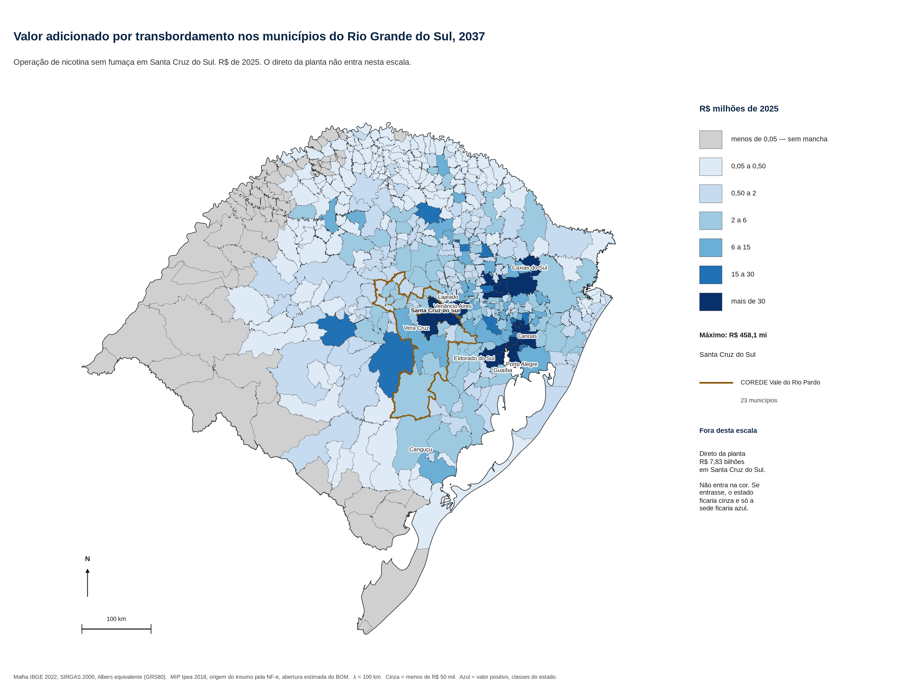
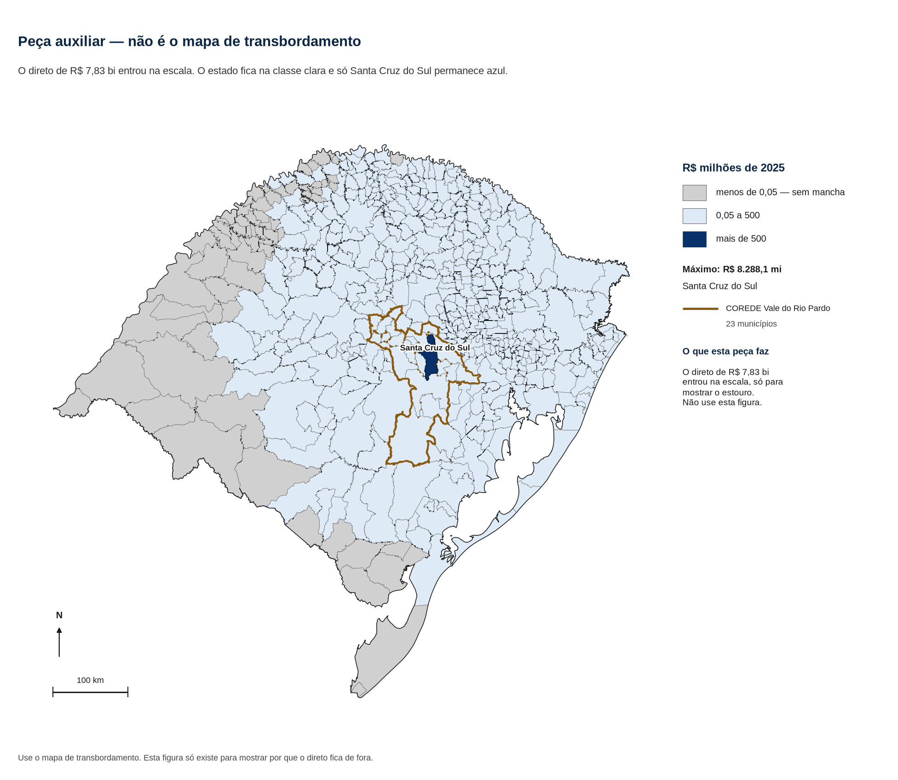
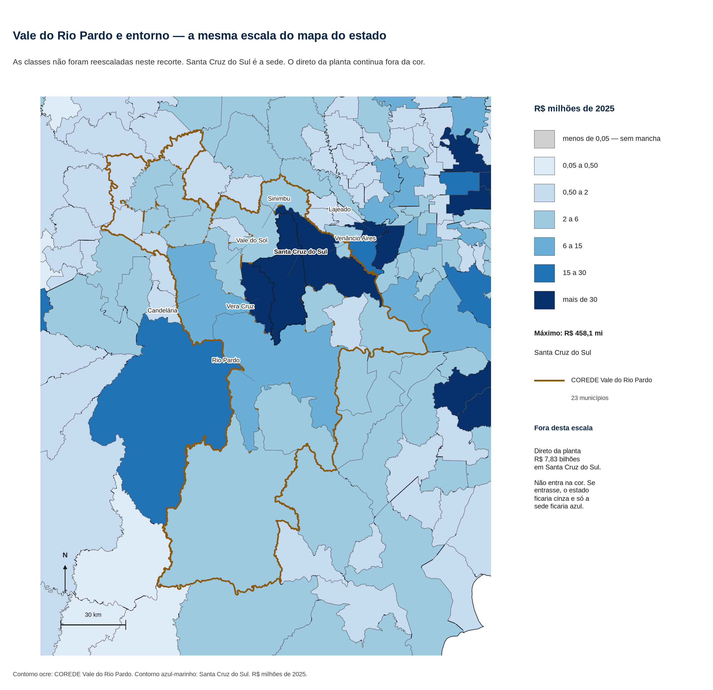

# Impacto econômico da operação de nicotina sem fumaça em Santa Cruz do Sul

Relatório final. Opção 2: MIP Ipea + MIP-RS. Santa Cruz do Sul. Ano cheio 2037. Reais de 2025. Matriz principal: MIP inter-regional Ipea–Receita Federal, 2018, 27 UFs × 68 atividades, release v1, feita com notas fiscais eletrônicas. Coluna de checagem: MIP-RS 2019, DEE/SPGG e UFRJ. Outubro de 2026.

Este documento reúne a conta de insumo-produto e a regionalização do transbordamento no Rio Grande do Sul. A planilha que reproduz cada número de manchete é `estudo/planilha_final_opcao2.xlsx`.

## 1. Para o leitor

O objeto medido é a operação, em 2037, de uma planta de produtos de nicotina sem fumaça na fábrica já existente da Philip Morris Brasil em Santa Cruz do Sul. Os produtos são sticks de tabaco aquecido, e-líquido com nicotina de folha brasileira e sachês só de exportação.

A matriz que propaga o choque é a MIP inter-regional do Ipea com a Receita Federal, ano-base 2018. A MIP-RS 2019 fica ao lado, com os números já calculados, para checar a ordem de grandeza. As duas contas usam a mesma planta e o mesmo ano. Elas não se somam.

| Leitura, 2037, R$ de 2025 | MIP Ipea, tipo I | MIP-RS 2019, checagem |
|---|---:|---:|
| Valor adicionado direto da planta | R$ 7.830,0 mi | R$ 7.830,0 mi |
| Indireto que cai no RS | R$ 1.772,9 mi | R$ 498,9 mi (cadeia) |
| Indireto que cai no resto do Brasil | R$ 3.384,6 mi | fora da inversa |
| Tipo I no RS (direto + indireto no RS) | R$ 9.602,9 mi | R$ 8.328,9 mi |
| Induzido, uma rodada, só no RS | R$ 627,8 mi, à parte | R$ 370,8 mi |
| Total com a rodada de consumo | fora da manchete | R$ 8.699,7 mi (tipo II) |
| Compra endereçada ao RS | R$ 3.574,5 mi | R$ 830,0 mi |

A manchete principal é a da MIP Ipea em tipo I: direto de R$ 7,83 bilhões mais indireto inter-regional que cai no Rio Grande do Sul, R$ 1,77 bilhão. O tipo I no RS é R$ 9,60 bilhões. O induzido de R$ 627,8 milhões é complemento e fica de fora dessa soma. O indireto que cai nos outros estados, R$ 3,38 bilhões, é o vazamento agora medido.

O indireto Ipea no RS é 255% maior que a cadeia da MIP-RS (R$ 1.772,9 milhões contra R$ 498,9 milhões). Essa diferença fica fora da banda de 10% a 20% que as premissas tratavam como faixa típica de conteúdo local. O tipo I no RS, que carrega o mesmo direto de R$ 7,83 bilhões, fica 15,3% acima do tipo I da MIP-RS (R$ 9,60 bilhões contra R$ 8,33 bilhões). Essa segunda diferença cai dentro da banda, porque o direto é comum e grande. A origem do insumo agora é a NF-e; a abertura do que a planta compra continua estimada.

A compra que a NF-e endereça ao RS é R$ 3,57 bilhões, dos quais R$ 3,52 bilhões não são folha. O conteúdo local dos insumos que não são folha passa a 44,7%. O percentual manual da rodada anterior era 9,9%, e a faixa de sensibilidade era 10%, 20% e 35%. 44,7% fica fora dessa banda. O dispositivo, sozinho, entra com 40,5% de oferta gaúcha na TRU, no lugar do 5% manual.

O emprego direto permanece 4.060 ocupações. O indireto no RS soma 15.703 ocupações. O tipo I no RS soma 19.763 ocupações. O induzido, à parte, soma 8.022. O indireto no resto do Brasil soma 32.721 ocupações.

O transbordamento que o mapa reparte é o indireto Ipea no RS mais o induzido no RS: R$ 2.400,7 milhões. A parcela no COREDE Vale do Rio Pardo é 26,8%. O direto de R$ 7,83 bilhões continua inteiro em Santa Cruz do Sul, fora da cor.

A obra de conversão fica num bloco próprio, de 2026–2027, com o número já calculado na MIP-RS, e fica fora de 2037.

## 2. O projeto e as premissas contábeis

A planta fica em Santa Cruz do Sul, na unidade já existente, CNAE 12.20-4. O cenário das premissas é de mercado nacional regulado, com 9,9 milhões de usuários no canal legal em 2037, mais exportação para onze países da América Latina. A premissa trata o mercado atual desses produtos como abastecido pelo canal ilegal.

| Linha | Destino em 2037 | Volume |
|---|---|---:|
| E-líquido (pod de 11,36 mL; o custo inclui o dispositivo) | Mercado interno e exportação | 3,074 bilhões de mL |
| Sticks de tabaco aquecido | Mercado interno e exportação | 12,338 bilhões de sticks |
| Sachês de nicotina oral | Só exportação | 0,138 bilhão de unidades |

A receita ex-fábrica a preço básico é de R$ 15,83 bilhões: R$ 12,56 bilhões no mercado interno e R$ 3,27 bilhões FOB, premissas da revisão 4. Essa receita é o teto contábil da planta. Ela permanece fora do vetor que entra na matriz. A coluna “fabricação de produtos do fumo” da MIP Ipea recebe choque zero.

A fábrica compra a folha ao produtor, a preço de porteira. Em 2037 a compra no Sul é de 6,51 mil toneladas, R$ 114,2 milhões. A parcela gaúcha, na âncora já publicada, é de 3.007 toneladas e R$ 52,8 milhões. Pela regra de 5,5 toneladas por família, essa compra no RS equivale a 547 famílias. Família-equivalente é escala de compra. Ela fica ao lado das ocupações e fora da soma de empregos.

A folha de Santa Catarina e do Paraná é o restante, R$ 61,4 milhões, repartido na proporção 29:25 já definida para os 54% do Sul que não são gaúchos. Santa Catarina fica com R$ 33,0 milhões e o Paraná com R$ 28,4 milhões. As duas parcelas entram na agricultura desses estados. Não entram na agricultura do RS.

A capacidade de cigarros já instalada, cerca de 15 bilhões de cigarros por ano e cerca de 1,6 mil colaboradores, permanece fora do cenário. A depreciação e a despesa financeira também ficam fora do choque de produção.

### Ficha por unidade, herdada do v6

| | E-líquido | Stick | Sachê |
|---|---:|---:|---:|
| Volume em 2037 | 3,074 bi mL | 12,338 bi sticks | 0,138 bi sachês |
| Dos quais exportação | 0,956 bi mL | 0,918 bi sticks | 100% |
| Insumo por unidade | R$ 2,14 / mL | R$ 0,111 / stick | R$ 0,268 / sachê |
| Folha por unidade | 0,90 g / mL | 0,30 g / stick | 0,27 g / sachê |
| Preço da folha | R$ 15 mil / t | R$ 19,5 mil / t | R$ 15 mil / t |
| Ocupações por milhão de unidades | 0,92 | 0,097 | 0,20 |
| Remuneração por mil unidades | R$ 138 | R$ 14,57 | R$ 30 |

O e-líquido concentra o custo de insumos porque o dispositivo entra no custo do pod. A 0,90 g de folha por mL, com nicotina típica de 2% na folha, a formulação implícita é de cerca de 20 mg de nicotina por mL. Essa leitura calibra o custo de extração. Ela deixa a folha em R$ 114 milhões.

### A rampa até 2037, só na planta

O arquivo traz a trajetória direta da fábrica. Esta rodada multiplica o ano cheio de 2037. A rampa abaixo permanece fora da matriz. Fonte: premissas, revisão 4.

| Indicador direto | 2028 | 2032 | 2037 |
|---|---:|---:|---:|
| Receita ex-fábrica | R$ 4,70 bi | R$ 10,68 bi | R$ 15,83 bi |
| Valor adicionado da planta | R$ 2,39 bi | R$ 5,07 bi | R$ 7,83 bi |
| Ocupações na planta | 1,19 mil | 2,81 mil | 4,06 mil |
| Remunerações | R$ 178 mi | R$ 421 mi | R$ 609 mi |
| Folha comprada no RS | R$ 16 mi | R$ 35 mi | R$ 53 mi |

A soma de ocupações-ano de 2028 a 2037 no arquivo, 28,2 mil, é a soma de dez estoques anuais. A manchete de emprego direto permanece o estoque de 2037, 4,06 mil ocupações.

### O que a conta usa em 2037

| Item | Com exportação | Papel na conta |
|---|---:|---|
| Receita ex-fábrica, preço básico | R$ 15,83 bi | Teto contábil. Fora do vetor de choque |
| Insumos | R$ 8,00 bi | Base das compras |
| Valor adicionado direto | R$ 7,83 bi | Gaveta direta, uma vez, em Santa Cruz do Sul |
| Remunerações diretas | R$ 609 mi | R$ 150 mil por ocupação, com encargos |
| Ocupações diretas | 4,06 mil | Estoque de 2037 |
| Folha no RS | 3.007 t; R$ 52,8 mi | Agricultura do RS |
| Folha em SC e no PR | R$ 33,0 mi e R$ 28,4 mi | Agricultura desses estados |
| Adicionalidade | 100% | Premissa de capa |

Cargas de memória do cenário, nas premissas: 39% do preço de varejo no vape e no sachê e 51% no tabaco aquecido. A meta de tributos sobre o consumo no Brasil em 2037 é R$ 13,7 bilhões. A parcela do consumo no RS é cerca de 6,8%, R$ 0,93 bilhão, dos quais R$ 0,48 bilhão estaduais e municipais. O IRPJ/CSLL da planta, pela regra do arquivo (34% sobre 50% do excedente), é R$ 1,23 bilhão, federal. O tratamento fiscal está na seção 7.

### Leitura salarial, com a premissa mantida

As 4.060 ocupações e os R$ 609 milhões permanecem. R$ 150 mil por ocupação, com encargos, é a premissa v6.

O confronto usa duas fontes de folha de pagamento da indústria do fumo, trazidas a R$ de 2025 pelo IPCA (SIDRA 1737).

| Fonte | O que mede | Em R$ do ano | Em R$ de 2025 | Com encargos patronais de 36,8% |
|---|---|---:|---:|---:|
| CEMPRE, IBGE, tabela 6450, 2021, Santa Cruz do Sul, divisão 12 | R$ 338 milhões de salários para 3.136 assalariados | R$ 108 mil / pessoa | R$ 130 mil | R$ 178 mil |
| PIA-Empresa, IBGE, tabela 1849, 2023, Rio Grande do Sul, divisão 12 | R$ 733 milhões para 6.165 pessoas ocupadas em 31/12 | R$ 119 mil / pessoa | R$ 130 mil | R$ 178 mil |
| Premissa v6 | Ocupação com encargos | | | R$ 150 mil |

Os 36,8% são a soma das alíquotas legais que estão fora de “salários e outras remunerações”: INSS patronal 20%, RAT 3%, Sistema S e salário-educação cerca de 5,8%, FGTS 8%. É alíquota de referência. O 13º já está na rubrica anual do CEMPRE e da PIA.

R$ 150 mil fica cerca de 16% abaixo dos R$ 178 mil. O sentido do viés é para baixo: a premissa aceita é baixa frente ao custo carregado da indústria do fumo gaúcha em 2021–2023. A premissa entra na conta como está.

## 3. Abertura estimada dos insumos

O arquivo fixa o bolo: insumos de R$ 8,00 bilhões, dos quais a folha é R$ 114,2 milhões. O restante, R$ 7,89 bilhões, foi aberto por engenharia de porte e por preço público na rodada anterior. Esta conta reusa essa abertura de produtos. O que muda é a origem geográfica: cada real do produto vai para a UF que, na TRU Ipea, oferta esse produto ao consumo intermediário do Rio Grande do Sul.

As linhas publicadas somam R$ 7.885,8 milhões fora da folha. Com a folha de R$ 114,2 milhões, o vetor fecha em R$ 7.999,97 milhões. A diferença de R$ 30 mil para a âncora de R$ 8.000 milhões já estava no fator de encaixe da abertura publicada. Ela não foi reaberta.

### O que a física explica e o que o dispositivo absorve

No pod, a química cabe em pouco. Com densidade de cerca de 1,15 g/mL, nicotina de 20 mg/mL, aroma a 10% da massa e o restante em partes iguais de glicerina e propilenoglicol, os preços industriais de ponto médio explicam cerca de R$ 128 milhões de químicos no e-líquido, incluída a extração de nicotina além da folha. São cerca de R$ 0,50 por pod.

O custo de insumos do pod é de cerca de R$ 24. O residual, R$ 6,29 bilhões no ano, é o dispositivo e a eletrônica. A R$ 5,59 por dólar, PTAX venda média de 2025, isso é cerca de US$ 4 por pod. A mão de obra está nos R$ 609 milhões de remuneração.

No stick, a folha já saiu a R$ 19.500/t. O que sobra por stick é sobretudo papel, filtro e embalagem, R$ 1,12 bilhão. Glicerina do bastão, ligante e aroma somam R$ 47 milhões.

### Energia, água, frete e manutenção

A intensidade de partida é a da manufatura da PMI em 2022: 7,56 GJ por milhão de cigarros-equivalentes. O resultado estimado é 72 mil MWh e R$ 39,5 milhões de energia, cerca de 130 mil m³ e R$ 1,9 milhão de água, R$ 51,5 milhões de frete interno até a planta e R$ 119,3 milhões de manutenção. São ordens de grandeza da abertura, declaradas como estimativa. A origem de cada uma, nesta rodada, deixa de ser o percentual manual e passa a ser a oferta observada na TRU.

### A abertura e a origem que a NF-e implica

Valores em R$ milhões de 2025. A parcela RS é a participação da oferta gaúcha no consumo intermediário do RS, lida na TRU, aplicada ao valor estimado da linha. A folha segue a âncora, não a TRU.

| Linha | Valor | Parcela RS | Valor no RS | Resto do Brasil |
|---|---:|---:|---:|---:|
| Dispositivo e eletrônico do pod | 6.294,7 | 40,5% | 2.549,6 | 3.745,1 |
| Químicos | 192,5 | 53,4% | 102,7 | 89,8 |
| Papel, filtro e embalagem | 1.186,2 | 61,8% | 732,7 | 453,5 |
| Energia | 39,5 | 16,9% | 6,7 | 32,8 |
| Água | 1,9 | 99,5% | 1,9 | 0,0 |
| Frete interno | 51,5 | 16,9% | 8,7 | 42,8 |
| Manutenção | 119,3 | 100% | 119,3 | 0,0 |
| Insumos que não são folha | 7.885,8 | 44,7% | 3.521,7 | 4.364,1 |
| Folha no RS | 52,8 | âncora | 52,8 | |
| Folha em SC | 33,0 | | | 33,0 |
| Folha no PR | 28,4 | | | 28,4 |
| Insumos no vetor | 7.999,97 | | 3.574,5 | 4.425,5 |

A soma das linhas com uma casa pode diferir em um décimo do total da coluna, que é o valor antes do arredondamento. O conteúdo local de 44,7% nos insumos que não são folha fica fora da banda de 10% a 20%. A origem do insumo agora é a NF-e; a abertura do que a planta compra continua estimada.

Duas linhas merecem leitura explícita. Eletricidade e frete de carga, na oferta ao RS, têm só 16,9% de origem gaúcha: a TRU atribui parcela grande a São Paulo, Rio de Janeiro, Santa Catarina e Paraná, padrão compatível com a sede da empresa que fatura, não com o poste ou com o caminhão que chega a Santa Cruz. As duas linhas somam R$ 91 milhões. Elas não movem a manchete. Quem move é o dispositivo, R$ 6,29 bilhões com 40,5% de oferta gaúcha, e o papel, R$ 1,19 bilhão com 61,8%.

A TRU não traz uma linha de importação por produto. A participação de cada UF é a participação na oferta doméstica ao RS, e a soma das 27 UFs é 100% do valor estimado da linha. O chute antigo de 85% importado no dispositivo sai da conta. O que a NF-e observa é a nota entre estabelecimentos brasileiros.

## 4. Como a MIP Ipea foi aplicada

Quatro peças na operação de 2037, e um bloco de obra que permanece separado.

**Peça 1, efeito direto.** Valor adicionado, ocupações e remunerações da planta, uma vez, em Santa Cruz do Sul, com os números da revisão 4. A receita de R$ 15,83 bilhões não entra no vetor.

**Peça 2, indireto inter-regional.** O BOM, a preço básico, deflacionado a 2018, é demanda intermediária. Para cada produto da abertura há uma atividade da lista de 68. A origem é a oferta daquele produto ao consumo intermediário das 68 atividades gaúchas, por UF, na aba Usos da TRU. Dentro da UF de origem, a matriz de recursos reparte o produto entre as atividades que o produzem. O vetor f tem dimensão 1.836. A inversa é x = (I − A)⁻¹ f, com A tirada das transações inter-regionais divididas pelo valor da produção de cada coluna.

**Peça 3, indireto no resto do Brasil.** É a parte de x que cai fora do RS, convertida em valor adicionado pelo coeficiente de valor adicionado bruto da própria MIP. É vazamento medido.

**Peça 4, induzido, à parte.** A MIP Ipea é tipo I: o consumo das famílias está na demanda final, fora de A. A camada induzida pega 60% da massa salarial gerada no RS (os R$ 609 milhões da planta mais a remuneração indireta que cai no RS) e aplica uma rodada, só sobre a oferta gaúcha ao consumo das famílias do RS. O valor adicionado induzido da manchete é o que cai no RS. O pedaço dessa rodada que cai fora do RS, R$ 196 milhões, fica registrado e fora da manchete.

**Bloco de obra, 2026–2027.** Permanece o número já calculado na MIP-RS. A razão está na seção 6. Não se soma a 2037.

O script é `estudo/scripts/calcular_impacto_ipea.py`. Ele baixa o release v1 para `/tmp/mip-ipea` e não versiona a planilha. Antes do choque da planta, a demanda final doméstica da própria MIP, passada pela inversa, reproduz o valor da produção de cada uma das 1.836 colunas. O erro relativo máximo dessa conferência é da ordem de 10⁻¹⁵. A soma do vetor f, trazida de volta a 2025, é R$ 8,00 bilhões.

O fator de preço é o IPCA, SIDRA 1737, número-índice: 5.100,61 em dezembro de 2018 e 7.403,29 em dezembro de 2025. φ = 5.100,61 / 7.403,29 = 0,688965. O fluxo de 2025 entra na matriz multiplicado por φ. O resultado volta a reais de 2025 pela divisão por φ. Ocupação não se deflaciona. O coeficiente 0,7186 da rodada anterior era dezembro de 2019 sobre dezembro de 2025 e não foi reusado.

### Ponte do produto do BOM para a atividade Ipea

| Linha do BOM | Produto na TRU | Atividade Ipea | Parcela que fica nessa atividade |
|---|---|---|---:|
| Dispositivo e eletrônico do pod | Material eletrônico e equipamentos de comunicações | Equipamentos de informática, eletrônicos e ópticos | 70% |
| Glicerina e propilenoglicol | Produtos químicos orgânicos | Químicos orgânicos e inorgânicos, resinas e elastômeros | 94% |
| Aroma, extração, químicos do stick e do sachê | Produtos químicos diversos | Defensivos, desinfestantes, tintas e químicos diversos | 66% |
| Papel, filtro e embalagem | Papel, papelão, embalagens e artefatos | Celulose, papel e produtos de papel | 98% |
| Energia | Eletricidade, gás e outras utilidades | Energia elétrica, gás natural e outras utilidades | 100% |
| Água | Água, esgoto, reciclagem e resíduos | Água, esgoto e gestão de resíduos | 100% |
| Frete interno | Transporte terrestre de carga | Transporte terrestre | 99% |
| Manutenção | Manutenção e instalação de máquinas | Manutenção, reparação e instalação de máquinas | 88% |
| Folha | Âncora do estudo, não a TRU | Agricultura do RS, de SC e do PR | 100% |

A coluna da direita é a parcela que a matriz de recursos mantém na atividade da ponte, na média ponderada das UFs de origem. O restante do produto, na mesma UF, vai para outras atividades que também o produzem. A chave de origem é a oferta para o RS, não a produção nacional sem destino.

## 5. Resultados do ano cheio de 2037

Cenário com exportação. R$ de 2025. Uma casa nos milhões. O tipo I da MIP Ipea é a manchete. O induzido está na tabela para ser lido ao lado, e fora da soma principal.

| Gaveta | Valor adicionado | Remunerações | Ocupações |
|---|---:|---:|---:|
| Direto, planta, Santa Cruz do Sul | R$ 7.830,0 mi | R$ 609,0 mi | 4.060 |
| Indireto no RS | R$ 1.772,9 mi | R$ 1.002,8 mi | 15.703 |
| Indireto no resto do Brasil | R$ 3.384,6 mi | R$ 1.702,0 mi | 32.721 |
| Tipo I no RS | R$ 9.602,9 mi | R$ 1.611,8 mi | 19.763 |
| Induzido no RS, uma rodada, à parte | R$ 627,8 mi | R$ 227,5 mi | 8.022 |

A produção indireta associada é R$ 4.384 milhões no RS e R$ 10.413 milhões no resto do Brasil. A massa salarial que alimenta o induzido é R$ 1.611,8 milhões. Sessenta por cento disso, R$ 967,1 milhões, entram como consumo sobre a oferta gaúcha.

<figure class="grafico">

<figcaption>Valor adicionado em 2037, reais de 2025. O tipo I no RS é direto mais indireto no RS. A barra do induzido não entra nessa soma. A barra do resto do Brasil é o vazamento medido.</figcaption>
</figure>

### Onde o indireto no RS acrescenta valor

As oito atividades com maior valor adicionado indireto no RS, em R$ milhões de 2025. A lista das 68, com a soma fechando R$ 1.772,9 milhões, está na planilha.

| Atividade no RS | Valor adicionado | Ocupações |
|---|---:|---:|
| Equipamentos de informática, eletrônicos e ópticos | 375,9 | 2.112 |
| Celulose, papel e produtos de papel | 323,3 | 1.414 |
| Máquinas e equipamentos elétricos | 308,4 | 2.104 |
| Comércio por atacado e a varejo | 219,3 | 3.592 |
| Borracha e material plástico | 109,7 | 1.134 |
| Agricultura | 58,6 | 1.288 |
| Manutenção e instalação de máquinas | 56,4 | 725 |
| Produtos de metal | 52,8 | 731 |

Eletrônicos e papel lideram porque são os dois maiores endereços da oferta gaúcha ao que a planta compra. Máquinas elétricas aparecem sobretudo pelo encadeamento, não por uma linha própria do BOM. A agricultura entra pela folha de R$ 52,8 milhões: o valor adicionado agrícola no RS é R$ 58,6 milhões, porque o coeficiente da atividade é aplicado sobre a produção gerada, que inclui a folha e o encadeamento.

<figure class="grafico">

<figcaption>Indireto no RS por atividade. MIP Ipea, tipo I, 2037.</figcaption>
</figure>

| Origem | Ocupações em 2037 | Como ler |
|---|---:|---|
| Planta | 4.060 | Premissa v6. Estoque do ano cheio. Uma vez |
| Indireto no RS | 15.703 | Fator trabalho da MIP Ipea sobre a produção gerada no RS |
| Indireto no resto do Brasil | 32.721 | O mesmo fator, fora do RS |
| Induzido no RS, à parte | 8.022 | Uma rodada de consumo. Fora do tipo I |
| Famílias-equivalentes da folha no RS | 547 | 3.007 t ÷ 5,5 t. Fora da soma |

<figure class="grafico">

<figcaption>Ocupações em 2037. O direto entra uma vez. O induzido fica à parte do tipo I.</figcaption>
</figure>

### O vazamento medido, por estado

Valor adicionado indireto, R$ milhões de 2025. É a parte de x que cai em cada UF. O RS está na primeira linha para leitura; a manchete do vazamento é a soma dos outros 26.

| UF | Choque de origem | Valor adicionado indireto |
|---|---:|---:|
| RS | 3.574,5 | 1.772,9 |
| SP | 1.057,0 | 1.139,0 |
| PR | 1.829,0 | 630,7 |
| SC | 473,1 | 331,8 |
| RJ | 199,1 | 301,2 |
| MG | 209,1 | 244,6 |
| AM | 416,0 | 63,3 |
| Demais UFs | 242,3 | 674,0 |
| Brasil sem o RS | 4.425,5 | 3.384,6 |

O Paraná recebe choque alto porque a folha paranaense, o papel e o eletrônico têm oferta paranaense relevante para o RS. O Amazonas recebe R$ 416 milhões de choque, sobretudo eletrônico, e R$ 63 milhões de valor adicionado: o coeficiente de valor adicionado dessa oferta é baixo. São Paulo é o maior vazamento em valor adicionado, R$ 1,14 bilhão.

### A coluna MIP-RS, mesma planta

A MIP-RS 2019, 117 produtos × 52 atividades, DEE/SPGG e UFRJ, foi a matriz da rodada anterior. Os números abaixo são os já publicados. Eles não foram reestimados e não entram na soma da MIP Ipea.

| | MIP-RS 2019 |
|---|---:|
| Compra no RS, com o percentual manual | R$ 830,0 mi |
| Cadeia (indireto estadual) | R$ 498,9 mi |
| Induzido, uma rodada | R$ 370,8 mi |
| Tipo I no RS | R$ 8.328,9 mi |
| Tipo II no RS | R$ 8.699,7 mi |
| Ocupações do tipo II | 12.817 |

A diferença do indireto no RS é R$ 1.274,0 milhões, 255% acima da cadeia da MIP-RS. Fora da banda de 10% a 20%. A diferença do tipo I é R$ 1.274,0 milhões sobre uma base de R$ 8.328,9 milhões, 15,3%, dentro da banda, porque os dois lados carregam os mesmos R$ 7,83 bilhões diretos. A origem do insumo agora é a NF-e; a abertura do que a planta compra continua estimada.

<figure class="grafico">

<figcaption>Parcela produzida no RS, pela oferta da TRU ao consumo intermediário gaúcho. As linhas tracejadas marcam 10% e 20%, a banda que as premissas tratavam como típica.</figcaption>
</figure>

<figure class="grafico">

<figcaption>Mesma planta. As barras não se somam. O bloco II do contratante, R$ 8,85 bilhões no RS, é comparação de ordem de grandeza, não insumo desta conta.</figcaption>
</figure>

O bloco II do contratante, no tipo I deles, traz R$ 8,85 bilhões e 12.760 ocupações no RS, e R$ 15,55 bilhões e 67.350 ocupações no Brasil. O tipo I desta conta no RS, R$ 9,60 bilhões e 19.763 ocupações, fica na mesma ordem de grandeza de valor do bloco II e acima em ocupação: o fator trabalho da MIP Ipea incide sobre uma compra gaúcha de R$ 3,57 bilhões. No Brasil, o indireto desta conta soma R$ 5,16 bilhões de valor adicionado (RS mais resto) e 48.424 ocupações indiretas, além das 4.060 diretas.

## 6. A obra de 2026–2027, em bloco separado

O terreno vale zero: a unidade já existe. O galpão também. O projeto é linha nova de sem fumaça dentro da planta, com operação a partir de 2028 e obra hipotética em 2026–2027. Este bloco permanece fora do ano cheio de 2037.

| Pedaço | Valor | Origem |
|---|---:|---|
| CAPEX da conversão | R$ 1.634,7 mi | Estimativa calibrada por anúncio, já publicada |
| Dos quais máquinas importadas | R$ 1.150,8 mi | Fora do choque |
| Parcela gaúcha | R$ 483,9 mi | Obra civil, montagem e engenharia |
| Produção gerada no RS | R$ 740,4 mi | MIP-RS 2019 |
| Valor adicionado no RS | R$ 341,8 mi | MIP-RS 2019 |
| Remunerações | R$ 125,5 mi | MIP-RS 2019 |
| Ocupações do Leontief da obra | 4.357 | MIP-RS 2019 |
| Das quais postos temporários na construção | 2.639 | MIP-RS 2019 |

A MAI inter-regional de 2018 foi inspecionada na coluna de investimento da fabricação de produtos do fumo no RS (RS_1200, R$ 183 milhões de 2018). Máquinas mecânicas são 40,4% dessa coluna, veículos 16,0%, construção 10,5%, manutenção 0,7%, engenharia 0,3%, e a origem “resto do mundo” é 38,5%. A parcela local já estimada é outra composição: obra civil cerca de 61%, montagem 28%, engenharia 11%, com a máquina importada já retirada. A MAI não reparte esse pedaço. O número da obra permanece o da MIP-RS 2019, com esse rótulo, e não se soma a 2037.

## 7. Retorno fiscal bruto e a hipótese FUNDOPEM

O incentivo não foi concedido à Philip Morris Brasil. O que segue é uma política hipotética de referência. Fonte do desenho: Lei 15.642/2021 e a Resolução Normativa do FUNDOPEM/INTEGRAR consolidada até a RN 11/2025.

**Hipótese de referência.** Financiamento de 30% do ICMS incremental atribuível ao consumo no Rio Grande do Sul, por 96 meses, sem abatimento do INTEGRAR. É hipótese de cálculo.

| Canal em 2037 | Valor | Esfera |
|---|---:|---|
| Tributos sobre o consumo no Brasil | R$ 13,7 bi | Federal R$ 6,58 bi; estados e municípios do Brasil R$ 7,12 bi |
| Tributos sobre o consumo no RS | R$ 0,93 bi | Dos quais R$ 0,45 bi federais e R$ 0,48 bi de ICMS |
| ICMS estadual, líquido da cota | R$ 360 mi | Estado |
| Cota-parte municipal do ICMS do consumo no RS | R$ 120 mi | Municípios gaúchos |
| Bruto estadual e municipal no RS | R$ 480 mi | Antes da hipótese |
| IRPJ/CSLL da planta | R$ 1,23 bi | Federal |
| Diferimento da hipótese (30% de R$ 480 mi) | R$ 144 mi | Caixa adiado |
| Líquido de caixa no ano em que a fruição vigora | R$ 336 mi | R$ 480 mi menos R$ 144 mi |
| ISS da obra em Santa Cruz do Sul | R$ 4,8 mi | Uma vez, em 2026–2027 |

O ISS usa a alíquota de 2% sobre metade da parcela local do CAPEX. Base de R$ 242 milhões × 2% = R$ 4,8 milhões, estimativa, município-sede, biênio da obra.

O tributo de R$ 480 milhões admite uma leitura pela população residente do Censo 2022. O COREDE tem 3,9% da população do Estado, o que lê R$ 18,7 milhões no Conselho e R$ 461,3 milhões no resto. Essa leitura não é cota-parte, VAF nem ISS.

## 8. Análise espacial: áreas de influência

O transbordamento que esta seção reparte é o indireto Ipea no RS mais o induzido no RS: R$ 1.772,9 milhões mais R$ 627,8 milhões, R$ 2.400,7 milhões. A soma dos 497 municípios é esse mesmo valor. A conta municipal reparte esse total pela regra já escrita: λ de 100 km, PAM para a folha, emprego do CEMPRE para o fornecedor, pendularidade para a casa de quem trabalha na sede. O direto de R$ 7,83 bilhões permanece inteiro em Santa Cruz do Sul, fora da cor.

A remuneração indireta no RS, R$ 1.002,8 milhões, supera a remuneração direta, R$ 609 milhões. Por isso a parcela do induzido que segue a residência de quem trabalha na planta é 37,8%, e o restante segue o núcleo gravitacional da massa já alocada na cadeia. Na rodada anterior, com a cadeia menor, essa parcela era 76,5%. A mancha induzida acompanha mais o fornecedor.

<figure class="mapa">

<figcaption>Transbordamento nos municípios do RS, 2037. Indireto Ipea no RS mais induzido. Cinza: menos de R$ 50 mil. Azul: valor positivo, classes do estado. O direto não entra na cor.</figcaption>
</figure>

A peça auxiliar soma o direto à cor, de propósito. As classes vão de R$ 500 milhões até o máximo, Santa Cruz do Sul com direto mais transbordamento. O Estado cai na classe clara e a sede fica isolada. A figura explica a escala. A peça de decisão é o mapa anterior.

<figure class="mapa">

<figcaption>Peça auxiliar. O direto de R$ 7,83 bilhões na mesma escala apaga o transbordamento do resto do Estado.</figcaption>
</figure>

### O método, com λ de 100 km

A malha é a municipal do IBGE 2022, 497 municípios, em Albers equivalente sobre o elipsoide GRS80. A distância é a euclidiana entre centroides, em quilômetros. A folha usa a PAM 2025, SIDRA 1612, fumo em folha: 349.928 toneladas no Estado, e a fração de 0,86% em 2037, que produz 3.009 toneladas contra a âncora de 3.007. O valor adicionado agrícola segue o peso da PAM e fecha no valor adicionado, não nas toneladas.

O fornecedor usa o pessoal ocupado do CEMPRE 2021, com decaimento exp(−d / 100 km), emprego elevado a 0,5, e raio de 260 km. A residência de quem trabalha na sede usa o Censo 2022: quem mora e trabalha no município, e quem trabalha em outro município repartido por um núcleo gravitacional de destinos concorrentes, com λ de 28 km e raio de 110 km. Na referência, 91,3% dessa massa mora em Santa Cruz do Sul.

O consumo induzido parte da massa salarial já alocada e de um núcleo de população, com λ de 75 km e raio de 180 km.

| λ (km) | Parcela do COREDE | Transbordamento na sede |
|---:|---:|---:|
| 80 | 29,0% | R$ 484 mi |
| 100 | 26,8% | R$ 458 mi |
| 150 | 24,5% | R$ 431 mi |

Com α = 1 e λ = 100 km, o COREDE cai a 23,8% e a sede fica em R$ 426 milhões. O λ de referência permanece 100 km.

### O zoom do Vale

<figure class="mapa">

<figcaption>Vale do Rio Pardo e entorno, nas mesmas classes do mapa do estado. Contorno ocre: COREDE. Contorno azul-marinho: Santa Cruz do Sul.</figcaption>
</figure>

### Os quinze municípios mais azuis

Transbordamento em R$ milhões de 2025. A soma dos 497 fecha R$ 2.400,7 milhões.

| Município | Transbordamento | Indústria | Serviços | Induzido | COREDE |
|---|---:|---:|---:|---:|---|
| Santa Cruz do Sul | 458,1 | 78,7 | 154,8 | 222,5 | sim |
| Porto Alegre | 88,2 | 62,3 | 8,2 | 17,7 | |
| Caxias do Sul | 81,0 | 69,2 | 3,3 | 8,6 | |
| Eldorado do Sul | 77,3 | 72,1 | 2,1 | 3,2 | |
| Gravataí | 71,0 | 61,2 | 1,9 | 8,0 | |
| Canoas | 70,2 | 56,4 | 3,5 | 10,2 | |
| Venâncio Aires | 61,5 | 47,5 | 4,5 | 5,9 | sim |
| Vera Cruz | 56,4 | 41,3 | 5,9 | 7,8 | sim |
| São Leopoldo | 56,0 | 45,3 | 2,5 | 8,2 | |
| Guaíba | 52,1 | 46,0 | 1,6 | 4,4 | |
| Cachoeirinha | 51,1 | 42,8 | 2,1 | 6,2 | |
| Bento Gonçalves | 48,6 | 40,7 | 2,6 | 5,3 | |
| Lajeado | 46,1 | 34,3 | 5,5 | 6,3 | |
| Estrela | 39,8 | 33,7 | 2,5 | 3,5 | |
| Farroupilha | 37,8 | 32,1 | 1,7 | 4,0 | |

A sede concentra salário e serviço. A mancha seguinte é metropolitana e da Serra, porque o indireto agora é sobretudo eletrônico, papel e máquina elétrica, e esses empregos estão em Eldorado do Sul, Gravataí, Canoas, Caxias do Sul e Porto Alegre. O anel do Vale — Venâncio Aires e Vera Cruz — continua azul, abaixo da região metropolitana.

### COREDE, sede e resto do Estado

| Recorte | Transbordamento | Parcela |
|---|---:|---:|
| COREDE Vale do Rio Pardo, 23 municípios | R$ 644,4 mi | 26,8% |
| Dos quais Santa Cruz do Sul | R$ 458,1 mi | 19,1% |
| COREDE sem a sede | R$ 186,3 mi | 7,8% |
| Resto do Estado | R$ 1.756,3 mi | 73,2% |
| Estado | R$ 2.400,7 mi | 100% |

A parcela do COREDE caiu em relação à rodada em que a cadeia gaúcha era R$ 499 milhões, porque o indireto adicional é indústria de eletrônico e de papel, com peso fora do Vale. Dentro dos R$ 2.400,7 milhões, a folha agrícola é R$ 58,6 milhões, a indústria R$ 1.360,7 milhões, os serviços da cadeia R$ 353,6 milhões e o induzido R$ 627,8 milhões.

Sessenta e seis municípios ficam abaixo de R$ 50 mil e somam R$ 1,1 milhão. No mapa são cinza. No CSV entram na soma. Dois fecham em zero: Barra do Quaraí e Chuí. A conferência da planilha, soma municipal menos indireto menos induzido, é zero em reais.

A prancha de leitura está em `estudo/espacial/prancha_governador.pdf`.

## 9. Limites

A abertura do que a planta compra continua estimada: dispositivo, papel, químicos, energia, água, frete e manutenção são engenharia de porte, não a nota fiscal da planta. A origem geográfica é que passou a ser observada.

A TRU mede a oferta doméstica ao consumo intermediário médio do RS. Ela não é o caderno de compras de uma planta de nicotina sem fumaça. Um pod pode ser mais importado do que a média do material eletrônico usado no Estado. Essa diferença não está na matriz, e por isso o conteúdo local de 44,7% pode estar alto para o dispositivo. O número fica publicado, com essa ressalva, no lugar do chute de 5%.

Eletricidade e frete herdam a geografia da sede de quem fatura. As linhas são pequenas.

O fator trabalho e o valor adicionado são os coeficientes médios de 2018 de cada atividade, em cada UF. Ocupação indireta não é um posto levantado na planta.

A adicionalidade de 100% é premissa de capa. A linha de cigarros já instalada permanece fora do choque.

A obra não se soma a 2037. A MIP Ipea não se soma à MIP-RS. O induzido não se soma ao tipo I na manchete principal.

### Onde cada número se confere

| Número | Onde |
|---|---|
| Âncoras da planta | Aba `01_premissas` da planilha e a revisão 4 |
| Abertura de produtos | `estudo/resultados/bom_abertura.csv` e a aba `02_bom` |
| Ponte e origem por UF | `ipea_ponte_bom.csv`, `ipea_origem_uf.csv`, abas `03` e `04` |
| Totais Ipea | `estudo/resultados/ipea_totais.json` |
| Inversa conferida | erro relativo máximo da ordem de 10⁻¹⁵, no json |
| Municípios | `estudo/espacial/va_por_municipio.csv`; conferência da aba `08` igual a zero |
| Coluna MIP-RS | `estudo/resultados/resultados.json`, chave `base`, sem recálculo |
| Script | `estudo/scripts/calcular_impacto_ipea.py` |

### Fontes

MIP, TRU e MAI inter-regionais, 2018, 68 atividades e 27 UFs: release v1, https://github.com/provictorludwig/mip-dados/releases/tag/v1 . Feitas com notas fiscais eletrônicas. Unidade da matriz: R$ milhões de 2018.

MIP-RS 2019, DEE/SPGG e UFRJ, 117 × 52: coluna de checagem e bloco da obra. https://dee.rs.gov.br/upload/arquivos/202409/11100149-20240906162755mip-rs-2019-117-52-v2-1.xlsx

IPCA: IBGE, SIDRA 1737, variável 2266. Dezembro de 2018: 5.100,61. Dezembro de 2025: 7.403,29.

PAM, CEMPRE, Censo 2022 e malha municipal: IBGE, como na nota `estudo/espacial/nota_metodo.md`.
